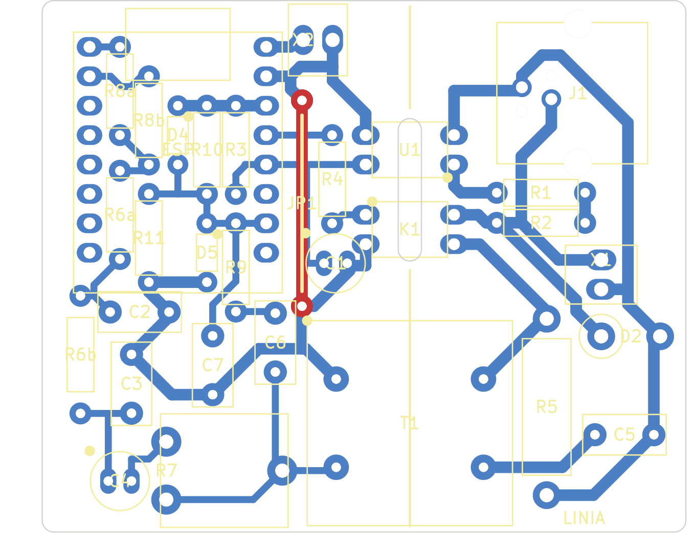
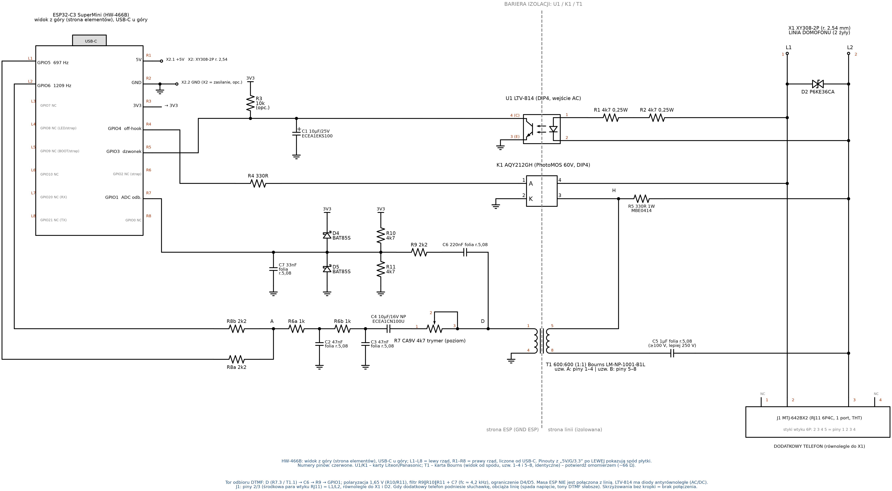
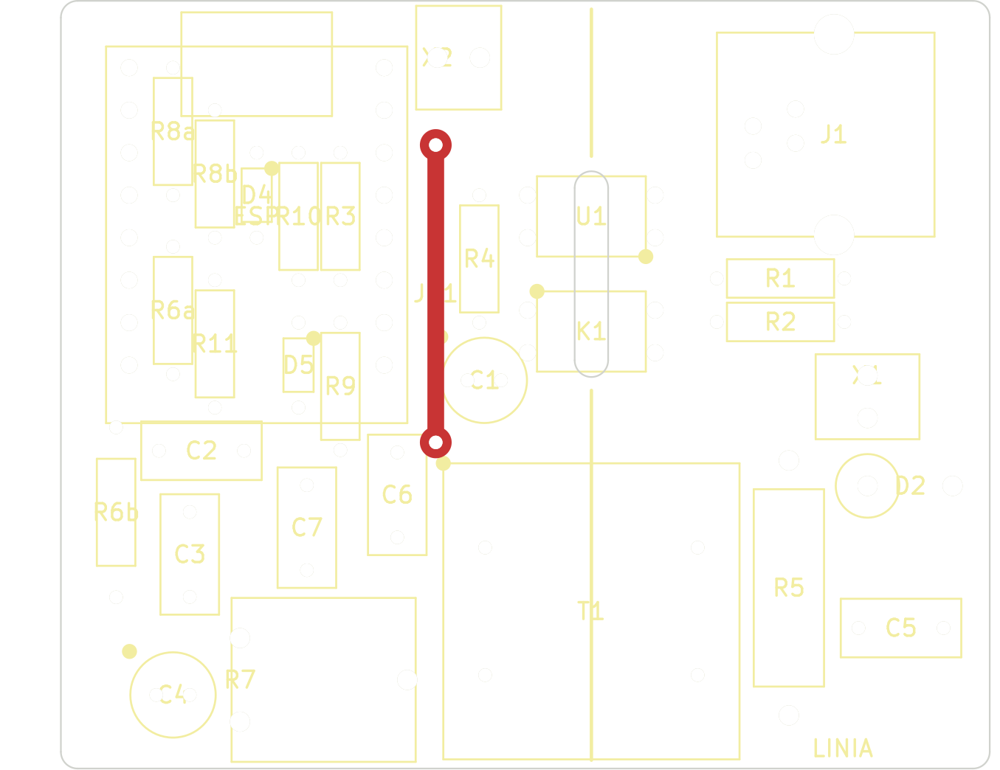
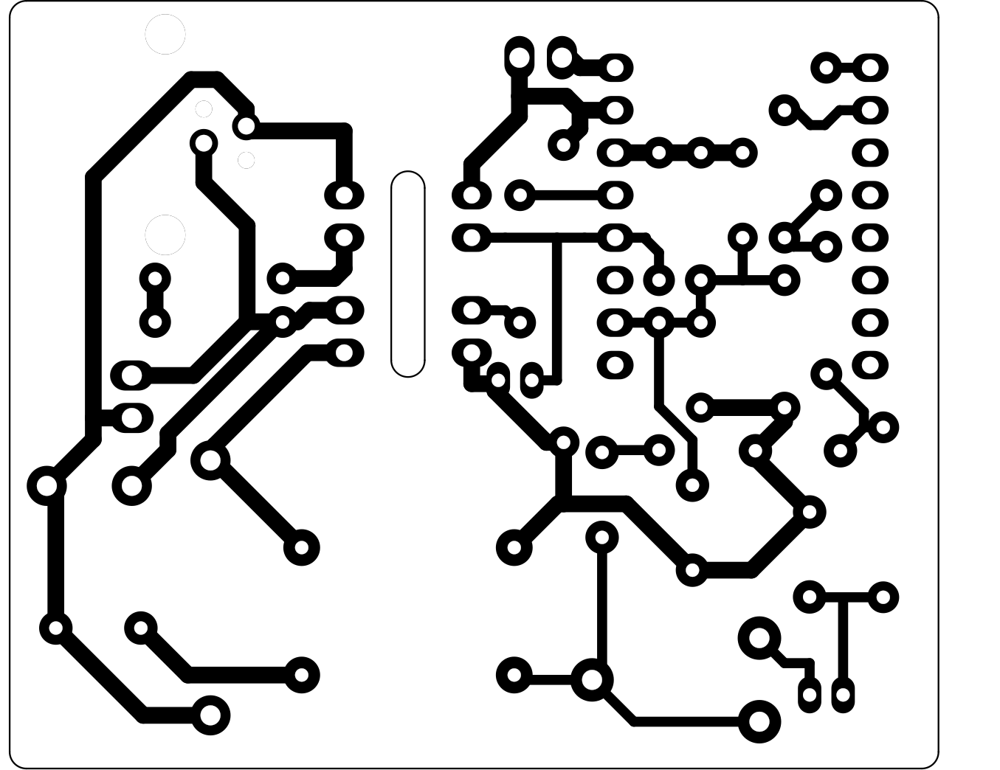

# domofon-esp32 — analog intercom ↔ ESP32-C3 / ESPHome / Home Assistant

An interface that connects a classic **2-wire analog intercom handset line** (Polish: *domofon*) to an
**ESP32-C3 SuperMini (HW-466B)** running **ESPHome**, so the intercom can be used from **Home Assistant**.

> **Status: design only — not yet tested on real hardware.** Schematic, single-sided PCB, BOM and firmware
> are complete; the board has passed KiCad DRC, but nothing has been built or measured yet.



## Features
- **Ring detection** — AC-input optocoupler (LTV-814) on the line, debounced input on GPIO3.
- **Off-hook** — PhotoMOS relay (AQY212GH) connects a load resistor and a 600:600 line transformer, just like lifting the handset.
- **DTMF transmit** — two hardware PWM tones (low + high group) summed and filtered, coupled through the transformer. Any DTMF digit is possible; the default firmware sends "1" to open the gate.
- **DTMF receive (software)** — line audio via the transformer to ADC1 (GPIO1), decoded on the ESP with a Goertzel filter bank (custom ESPHome component `dtmf_decoder`). Works only while off-hook.
- **Galvanic isolation** — ESP ground never touches the line; 4 mm isolation gap + milled slot on the PCB.
- **Extra handset jack** — RJ11 (J1) wired in parallel with the line.

### Home Assistant entities
| Entity | Name | What it does |
|---|---|---|
| `binary_sensor` | Domofon dzwonek | on while someone rings (50 ms on / 1.5 s off filter) |
| `button` | Domofon otwórz furtkę | off-hook → 0.8 s → DTMF "1" for 200 ms → on-hook after ~1 s |
| `switch` | Domofon off-hook | manual off-hook / on-hook (always off after reboot) |
| `event` | Domofon DTMF | fired for every decoded digit (0–9, *, #, A–D) |
| `text_sensor` | Domofon DTMF ostatnia cyfra | last decoded digit |
| `text_sensor` | Domofon DTMF sekwencja | digits concatenated, cleared after 3 s silence or on-hook |

## Schematic


## Repository layout
```
├── README.md
├── docs/
│   ├── design-notes.md          # English summary of the circuit
│   └── design-notes-pl.md       # full design notes (Polish): netlist, pin numbers, rationale
├── hardware/
│   ├── schematic/
│   │   ├── schematic.py         # source (schemdraw)
│   │   └── schematic.svg/.png   # generated output
│   ├── pcb/
│   │   ├── domofon.kicad_pro/.kicad_pcb/.kicad_dru   # KiCad 9 project (single-sided, THT)
│   │   ├── drc-report.txt       # KiCad DRC: 0 violations, 0 unconnected
│   │   ├── README-pl.md         # PCB notes (Polish)
│   │   ├── gerbers/             # Gerber X2 + Excellon (mm) — input for CNC
│   │   ├── previews/            # PNG renders
│   │   └── scripts/             # Python/KiCad generators, autorouting, DRC, export
│   └── bom/
│       ├── bom.csv              # full bill of materials
│       └── tme-order.csv        # the actual TME order
├── firmware/esphome/
│   ├── domofon.yaml
│   ├── secrets.yaml.example
│   └── components/dtmf_decoder/ # custom component: ADC + Goertzel DTMF decoder
├── cnc/README.md                # milling notes (PrintNC + Flexi-HAL/grblHAL), G-code TODO
└── tools/dtmf_sim.py            # offline simulation of the DTMF decoder algorithm
```

## PCB
- Single-sided (copper on B.Cu only), all parts THT on top, **55.6 × 46.0 mm**, designed for **isolation milling** with a 30° / 0.2 mm V-bit.
- Rules: clearance ≥ 0.4 mm, tracks 0.6 mm (signal) / 1.0 mm (power and line), no vias, **one wire jumper (JP1)**.
- Low parts sit under the ESP32-C3 module → mount the module on female headers (~8–11 mm).
- `gerbers/domofon-F_Cu-jumpers_DO_NOT_MILL.gtl` only models the wire jumper for DRC — **do not mill it**.

| Placement | Bottom copper (mirrored, as milled) |
|---|---|
|  |  |

## How to regenerate
Requirements: Python 3, `schemdraw` + `pillow`; KiCad 9 (`kicad-cli` and the `pcbnew` Python module); `rsvg-convert` (librsvg) for previews; optionally Freerouting 2.x + Java for re-routing.

```bash
# Schematic -> hardware/schematic/schematic.svg + schematic.png
cd hardware/schematic
python3 -m venv .venv && .venv/bin/pip install schemdraw pillow
.venv/bin/python schematic.py

# PCB checks and outputs (run from anywhere)
hardware/pcb/scripts/drc.sh              # DRC -> hardware/pcb/drc-report.txt
hardware/pcb/scripts/export_gerbers.sh   # -> hardware/pcb/gerbers/
hardware/pcb/scripts/make_previews.sh    # -> hardware/pcb/previews/

# Full re-generation of the board from footprints.py / netlist.py / placement.py (optional)
FREEROUTING_JAR=/path/to/freerouting.jar JAVA=java hardware/pcb/scripts/build_and_route.sh 30
#   -> hardware/pcb/work/routed.kicad_pcb ; review, then copy to hardware/pcb/domofon.kicad_pcb
```
Autorouting is not deterministic; the committed `domofon.kicad_pcb` is the reviewed result.

## Firmware
```bash
cd firmware/esphome
cp secrets.yaml.example secrets.yaml   # fill in Wi-Fi credentials
esphome run domofon.yaml
```

## CNC
See [cnc/README.md](cnc/README.md). Machine: PrintNC with Flexi-HAL (grblHAL). G-code is **not generated yet**.

## Safety
- **Measure the line first**: idle voltage, ring voltage (DC and AC), off-hook voltage and loop current. Pick R5 to match the original handset's current (typically 20–60 mA).
- Maximum line voltage must stay **below 60 V** (AQY212GH rating); the TVS D2 (36 V) must be above the normal working maximum. C5 on hand is rated 63 V.
- **Never connect the ESP ground to the intercom line.** Power the ESP from an isolated 5 V USB supply.
- Test on a bench supply through a resistor before connecting to the building installation.
- The intercom is part of the building installation — get the administrator's consent.
- Do not connect J1 to a public telephone line.

## Datasheets
Vendor datasheets are not included in the repo; see e.g.
[Adam Tech MTJ-642BX2](https://app.adam-tech.com/products/download/data_sheet/203851/mtj-642bx2-data-sheet.pdf),
[Bourns LM-NP-1001-B1L](https://www.tme.eu/pl/details/lm-np-1001-b1l/dlawiki/bourns/),
[Liteon LTV-814](https://www.tme.eu/pl/details/ltv-814/transoptory-wyjscie-tranzystorowe/liteon/),
[Panasonic AQY212GH](https://www.tme.eu/pl/details/aqy212gh/przekazniki-polprzewodnikowe/panasonic/).
