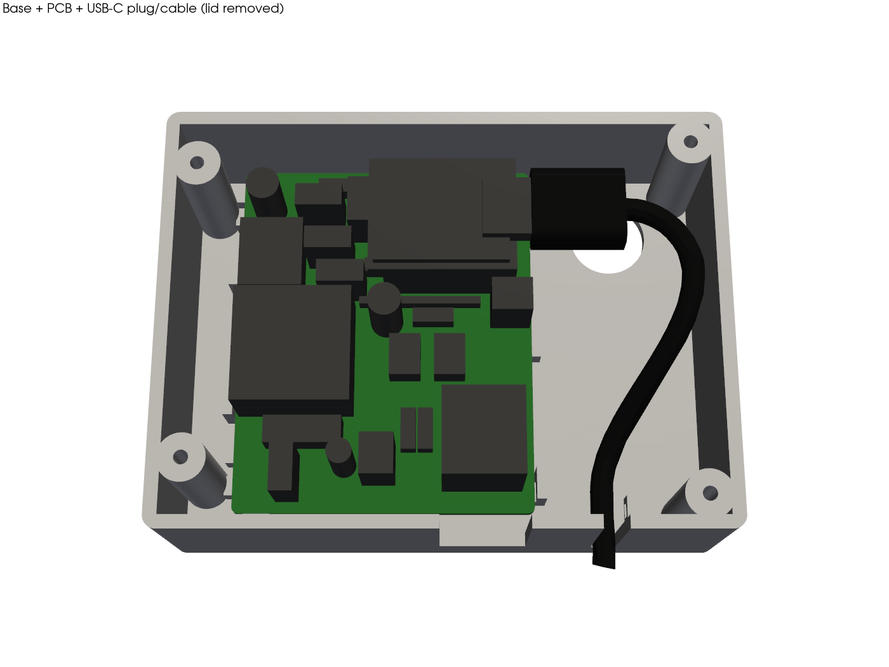

# 3D-printed enclosure — domofon-esp32

Flat wall-mounted box made of two printed parts: a **base** that is glued to the wall and a **lid** held by 4 screws.
The design is parametric (CadQuery). All dimensions live in `source/enclosure.py`, in the `P` dict at the top of the file.

| | |
|---|---|
| Outer size | **83.5 × 62.8 × 26.9 mm** (W × H × depth from the wall) |
| Walls / back / lid | 2.0 mm |
| PCB | 55.5 × 45.9 mm, mounted with the **J1 RJ11 opening facing down** |
| PCB fixing | no mounting holes on the PCB, so it sits on 11 ledges 3.5 mm above the back plate. Guides, the screw bosses and the top wall hold it sideways; 4 pins on the lid press it down |
| Cable exits (bottom) | RJ11 slot (J1, plug inserted from below) and USB-C cable slot with a strain-relief tongue on the lid |
| Phone cable from the wall | Ø12 hole in the back plate (hidden behind the box), slack space in the right-hand cable bay |
| Extras | screwdriver hole above trimmer R7, vent slots in the lid, cable-tie anchor next to the USB exit |



## Folder layout
```
hardware/enclosure/
├── source/
│   ├── enclosure.py                 # CadQuery model + interference check + exports
│   ├── render_previews.py           # PNG previews (pyvista)
│   ├── export_board_components.py   # PCB → board_components.json (system python + KiCad pcbnew)
│   └── board_components.json        # component bodies / positions exported from the PCB
├── stl/    enclosure_base.stl, enclosure_lid.stl          (already in print orientation)
├── 3mf/    enclosure_base.3mf, enclosure_lid.3mf, enclosure_plate_base_and_lid.3mf
├── step/   enclosure_base.step, enclosure_lid.step, enclosure_assembly_with_pcb.step
└── previews/  assembly_front.png, assembly_inside_no_lid.png, exploded.png,
               bottom_view_cable_exits.png, back_view_wall_hole.png, front_view.png
```

Regenerate:
```bash
python3 hardware/enclosure/source/export_board_components.py      # only if the PCB changed (needs KiCad 9)
python3 -m venv .venv-cad && .venv-cad/bin/pip install cadquery trimesh networkx lxml pyvista
.venv-cad/bin/python hardware/enclosure/source/enclosure.py        # prints the interference report
.venv-cad/bin/python hardware/enclosure/source/render_previews.py
```

## Coordinates and key positions
Front view, X measured from the **outer left edge** of the box:
- RJ11 J1 slot centre: **X = 47.4 mm**. The slot is 12.8 mm wide.
- USB-C cable exit centre: **X = 65.5 mm**, **7 mm from the wall**. It sits inside a 10 mm deep cable duct.
- Suggested duct centre for a 20 × 10 mm duct: **X ≈ 56.5 mm**. The `duct_w`/`duct_h` parameters only affect the preview.
  The USB cable falls straight into the duct. The RJ11 cable leaves the plug ~14 mm from the wall and must bend towards the duct below the box.
- Phone cable hole in the back: Ø12 mm, centre **68.4 mm from the outer left edge** and **11.8 mm below the outer top edge**.

---

## Instrukcja (PL)

### Druk (Bambu Lab P1S/P2S, Bambu Studio)
- Pliki `3mf/`:
  - `enclosure_plate_base_and_lid.3mf` – obie części na jednym stole;
  - albo osobno: `enclosure_base.3mf`, `enclosure_lid.3mf`.
- Orientacja jest już ustawiona:
  - **baza** leży tylną ścianką na stole;
  - **pokrywa** leży frontem na stole, a kołki dociskowe i krawędź centrująca są skierowane do góry.
- **Podpory: wyłączone** (nie są potrzebne).
- Materiał:
  - **PETG** – lepszy przy ścianie nasłonecznionej lub ciepłej;
  - **PLA** – wystarczy w mieszkaniu.
- Warstwa 0,2 mm, 3 obrysy (ścianki), wypełnienie 15–20 % gyroid, góra i dół po 4 warstwy.
- Tolerancje w modelu:
  - 0,3 mm luzu PCB ↔ prowadnice;
  - 0,25 mm luzu krawędzi pokrywy w bazie;
  - kołki pokrywy 0,1 mm nad PCB.
  Jeśli pokrywa wchodzi za ciasno, zmniejsz kompensację XY otworów albo zwiększ `clr` w `enclosure.py`.

### Do kupienia
- **4 × wkręt samogwintujący do tworzyw 2,5 × 10 mm** z łbem walcowym lub soczewkowym Ø ≤ 5,5 mm (np. typ PT / WN1411 K25×10, albo zwykły wkręt do plastiku 2,5×10). Otwór pilotowy w słupku: Ø2,1 mm.
  - Alternatywa: wkładki M3 wtapiane + śruby M3×8. Ustaw wtedy `screw_pilot=4.0` i `screw_clear=3.4`.
- Taśma dwustronna montażowa (piankowa, np. 3M VHB 19 mm): 2–3 paski na tylnej ściance, omijając otwór na kabel.
- Ewentualnie 1 opaska zaciskowa 2,5 mm (kotwa przy wyjściu USB).

### Składanie
1. Przeciągnij kabel telefoniczny ze ściany przez otwór w tylnej ściance bazy.
2. Przyklej bazę do ściany (wcześniej odtłuść ścianę). Otwór Ø12 musi trafić na wyjście kabla.
3. Zostaw zapas kabla w prawej komorze. Żyły poprowadź kanałem pod dolną krawędzią płytki (od strony ściany, pod gniazdem J1) do zacisków **X1** (wejście przewodów od dołu).
4. Wsuń płytkę elementami do przodu, J1 w dół. Płytka leży na półkach 3,5 mm nad dnem.
5. Podłącz przewody do X1. Włóż ESP32 w listwy, wepnij USB-C, poprowadź kabel łukiem w dół i włóż go w szczelinę w dolnej ściance (szczelina jest otwarta od strony pokrywy). Opcjonalnie przypnij kabel opaską do kotwy.
6. Załóż pokrywę: języczek dociśnie kabel USB, kołki dociśną płytkę. Przykręć 4 wkręty, z wyczuciem.
7. Trymer R7 reguluje się śrubokrętem przez otwór w pokrywie.
8. Wtyk RJ11 dodatkowego telefonu wkładasz od dołu w szczelinę. Zatrzask jest od strony pokrywy i da się go wcisnąć paznokciem lub cienkim śrubokrętem przez szczelinę.

### Założenia do sprawdzenia
- **Wysokość ESP32:** listwa żeńska 8,5 mm + plastik pinów męskich modułu 2,5 mm + PCB modułu 1,0 mm + USB-C 3,2 mm.
  - Jeśli moduł siedzi niżej (piny bez dystansu) albo listwa jest inna, zmień `fheader_h` / `mheader_spacer`.
  - Głębokość obudowy wynika z wtyku USB-C: grubość 6,5 mm, oś na wysokości USB, plus 1 mm luzu.
- **Wtyk USB-C:** sztywna część 14 mm, przekrój 12 × 6,5 mm. Kabel Ø3,5 mm, promień gięcia 10 mm.
  - Grubszy lub dłuższy wtyk wymaga zmiany `plug_len` / `plug_t` / `cable_d`.
  - Wtyk kątowy (90°) pozwoliłby zmniejszyć prawą komorę.
- **Wysokości elementów** są uproszczone (modele 3D w KiCad nie są przypisane):
  - kondensatory foliowe 10 mm, elektrolity 12 mm, T1 11 mm, J1 14,5 mm;
  - XY308 10 mm, D2 stojąca 11,5 mm, trymer 6,5 mm.
- **Kable:** RJ11 wychodzi ok. 14 mm od ściany, więc nie mieści się w korytku 10 mm bez zgięcia pod obudową. Kabel USB wychodzi 7 mm od ściany.
- **PCB:** prowadnice i półki zakładają frez konturowy zgodny z plikiem `06_outline` (55,5 × 45,9 mm).
